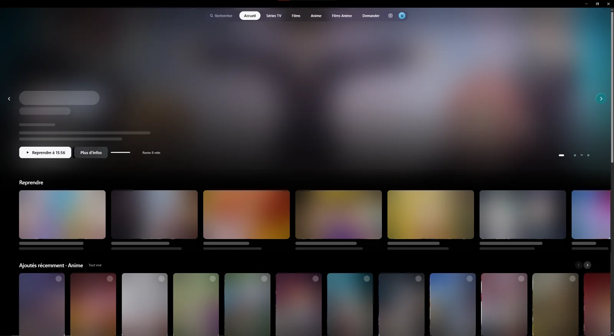
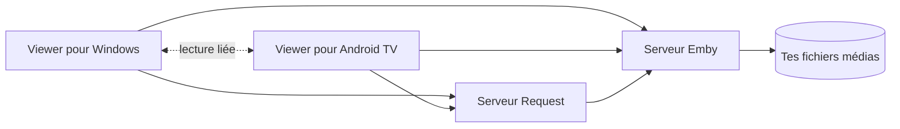

<div align="center">

# Viewer

**Ta bibliothèque Emby, sur une application Windows native, rapide, et sur ta télé.**

Français · [English](README.md)

[](LICENSE)

</div>

Viewer est un client multimédia personnel pour [Emby](https://emby.media). Il réunit une application de bureau Windows native et une application Android TV, toutes deux connectées uniquement à ton serveur Emby. La lecture passe avant tout : les vidéos démarrent vite, reprennent là où tu t'es arrêté et continuent quand le réseau flanche.



*L'accueil sous Windows (illustrations floutées).*

## Points forts

- **Reprends exactement où tu en étais.** Un bouton « Reprendre à 15:56 » sur le bandeau d'accueil, avec le temps restant à côté de la barre de progression.
- **Lecture fluide.** La vidéo est lue en direct dès que le serveur le permet, avec un repli en transcodage sinon. La lecture passe par le moteur natif libmpv, pas par une page web.
- **Retrouve vite ce que tu cherches.** Recherche, tri et filtres, favoris, pages d'épisode complètes et épisode suivant automatique. La navigation ne bloque jamais sur le réseau : écrans squelettes, cache d'images jetable et pagination la gardent réactive.
- **Regarde aussi sur grand écran.** Envoie un épisode du PC vers la télé et les deux restent synchronisés (l'écart mesuré s'affiche, par exemple « Lié à la TV, ±40 ms »). Pause, lecture et « Passer l'intro » fonctionnent depuis l'un ou l'autre.
- **Demande un titre sans quitter l'app.** Un onglet « Demander » intégré permet de parcourir, chercher et demander des films et séries qui ne sont pas encore sur ton serveur, sur Windows comme sur Android TV.
- **Connexion robuste.** La session survit aux redémarrages. Quand le serveur devient injoignable, l'app garde ta session, réessaie toute seule et te ramène là où tu étais.
- **À ton image.** Réorganise ou masque les rangées de l'accueil, choisis les langues audio et sous-titres, passe les génériques d'un bouton. Le logo change même de tenue aux fêtes, avec un réglage pour le couper.
- **Sûr par conception.** Ton jeton de connexion reste dans le stockage sécurisé du système, jamais dans un journal ni un fichier en clair. Les certificats du serveur sont vérifiés, et les mises à jour de l'app sont contrôlées par une signature cryptographique avant installation.

## Demander un titre sans quitter l'app

Les deux applications intègrent un onglet « Demander » qui relie Viewer à un serveur [Request](https://github.com/QuentinPN/request), le portail de demandes de ton serveur multimédia.

- **Le même compte, sans mot de passe en plus.** Viewer réutilise ton compte Emby pour se connecter à Request. Chaque appareil apparaît comme sa propre session, que tu peux révoquer.
- **Découvrir et chercher.** Parcours par type et par genre, ou cherche, puis ouvre un titre pour ses détails et ses bandes-annonces.
- **Demander en quelques clics.** Demande un film ou une série, avec ton quota restant affiché avant l'envoi.
- **Suivre tes demandes.** Retrouve « Mes demandes » avec leur statut, et annule-en une tant qu'elle est en attente.

L'onglet demande l'adresse d'un serveur Request ; le reste de Viewer fonctionne sans.

## Plateformes

| Plateforme | Expérience | Technologie |
|---|---|---|
| **Windows 10 / 11 (x64)** | Application de bureau avec fenêtre native, navigation au clavier et lecteur vidéo libmpv | Go, Wails v3, Svelte 5 |
| **Android TV** | Application pensée pour la télécommande, testée sur une NVIDIA Shield | Kotlin, Jetpack Compose |

L'interface est d'abord en français.

## Comment ça marche

Viewer n'est qu'un client. Emby reste la source de vérité pour les utilisateurs, les bibliothèques, la progression et l'état « vu » : rien de plus à héberger, et les deux applications sont toujours d'accord.



C'est le serveur qui décide comment chaque vidéo est livrée (lecture directe, flux direct ou transcodage). Viewer demande, puis lit le résultat.

## Démarrage

Viewer demande un serveur Emby auquel tu peux te connecter. Il est en développement actif et n'a pas encore d'installateur public : le plus court est de le lancer depuis les sources (Windows x64, Node 22 ou plus, Go, et le runtime WebView2, inclus dans Windows 11) :

```bash
npm ci
powershell -ExecutionPolicy Bypass -File scripts/fetch-libmpv.ps1
node scripts/e2e/app.mjs --build
go-app/bin/viewer-debug.exe
```

L'application Android TV se construit avec `./gradlew assembleDebug` depuis `android-tv/`. Les instructions complètes, les vérifications et l'état du projet sont dans le [guide développeur](docs/DEVELOPMENT.md).

## Construit avec


## Licence

Le code de Viewer est publié sous [licence MIT](LICENSE). La lecture vidéo utilise libmpv, téléchargée à la construction et absente de ce dépôt. La build utilisée aujourd'hui est sous licence GPL : Viewer n'est donc pas distribué sous forme de binaire prêt à l'emploi.

## Documentation

[Guide développeur](docs/DEVELOPMENT.md) · [Produit](PRODUCT.md) · [Design](DESIGN.md) · [Décisions](DECISIONS.md) · [Tests](TESTING.md)
