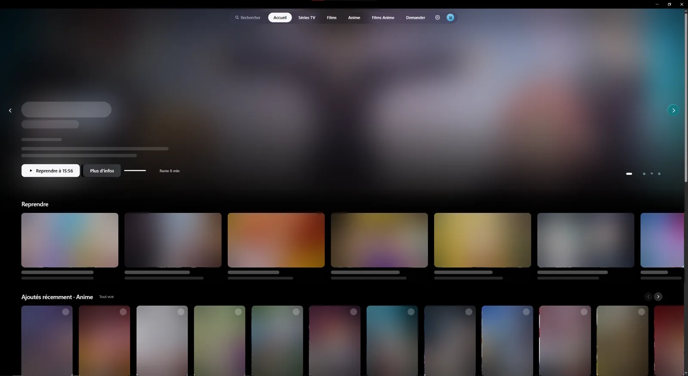
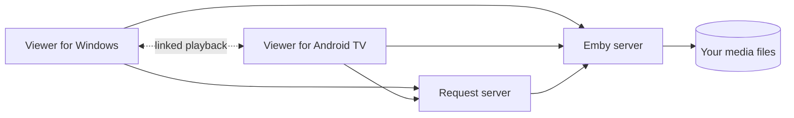

<div align="center">

# Viewer

**Your Emby library, on a fast, native Windows app and on your TV.**

[Français](README.fr.md) · English

[](LICENSE)

</div>

Viewer is a personal media client for [Emby](https://emby.media). It pairs a native Windows desktop app with an Android TV app, and both talk only to your Emby server. Playback comes first: videos start quickly, resume where you stopped, and keep going when the network hiccups.



*The Windows home screen (artwork blurred).*

## Highlights

- **Pick up exactly where you left off.** A "Resume at 15:56" button on the home banner, with the time remaining shown beside the progress bar.
- **Smooth playback.** Videos play directly whenever the server allows it and fall back to transcoding when it does not. Playback runs on the native libmpv engine, not in a web page.
- **Find things fast.** Search, sort and filters, favorites, full episode pages and automatic next episode. Browsing never blocks on the network: skeleton screens, a disposable image cache and paging keep it responsive.
- **Watch on the big screen too.** Send an episode from the PC to the TV and the two stay in sync (the measured offset is shown, for example "Linked to TV, +/-40 ms"). Pause, play and skip intro work from either device.
- **Request titles without leaving the app.** A built-in "Request" tab ("Demander") lets you browse, search and ask for films and series that are not on your server yet, on Windows and on Android TV.
- **Resilient connection.** Sessions persist across restarts. When the server becomes unreachable, the app keeps your session, retries on its own and brings you back to where you were.
- **Yours to arrange.** Reorder or hide the rows of the home screen, choose audio and subtitle languages, and skip intros with one button. The logo even changes outfit for holidays, with a setting to turn that off.
- **Safe by design.** Your sign-in token lives in the operating system's secure storage, never in a log or a plain file. Server certificates are validated, and in-app updates are checked against a cryptographic signature before they are installed.

## Request titles without leaving the app

Both apps include a "Request" tab (shown as "Demander" in the interface) that connects Viewer to a [Request](https://github.com/QuentinPN/request) server, the request portal for your home media server.

- **Same account, no extra password.** Viewer reuses your Emby account to sign in to Request. Each device appears as its own session, which you can revoke.
- **Discover and search.** Browse by type and genre, or search, then open a title for its details and trailers.
- **Ask in a couple of clicks.** Request a film or a series, with your remaining quota shown before you send.
- **Follow your requests.** See "my requests" with their status, and cancel one while it is still waiting.

The tab needs the address of a Request server; the rest of Viewer works without one.

## Platforms

| Platform | Experience | Technology |
|---|---|---|
| **Windows 10 / 11 (x64)** | Desktop app with a native window, keyboard navigation and a libmpv video player | Go, Wails v3, Svelte 5 |
| **Android TV** | Remote-friendly app, tested on an NVIDIA Shield | Kotlin, Jetpack Compose |

The interface is in French first.

## How it works

Viewer is only a client. Emby stays the source of truth for users, libraries, progress and watched state, so nothing extra has to be hosted and both apps always agree.



The server decides how each video is delivered (direct play, direct stream or transcode). Viewer asks, then plays the result.

## Getting started

Viewer needs an Emby server you can sign in to. It is in active development and there is no public installer yet, so the shortest path is to run it from source (Windows x64, Node 22 or later, Go, and the WebView2 runtime, which ships with Windows 11):

```bash
npm ci
powershell -ExecutionPolicy Bypass -File scripts/fetch-libmpv.ps1
node scripts/e2e/app.mjs --build
go-app/bin/viewer-debug.exe
```

The Android TV app builds with `./gradlew assembleDebug` from `android-tv/`. Full instructions, checks and project status are in the [developer guide](docs/DEVELOPMENT.md) (in French).

## Built with


## License

Viewer's own code is released under the [MIT License](LICENSE). Video playback uses libmpv, which is downloaded at build time and is not part of this repository. The build currently used is licensed under the GPL, so Viewer is not distributed as a ready-made binary.

## Documentation

[Developer guide](docs/DEVELOPMENT.md) (in French) · [Product](PRODUCT.md) · [Design](DESIGN.md) · [Decisions](DECISIONS.md) · [Testing](TESTING.md)
